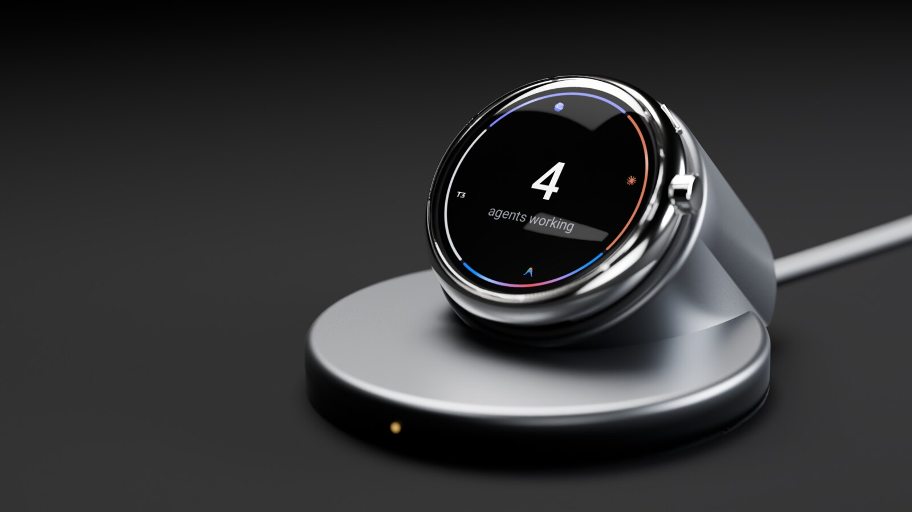
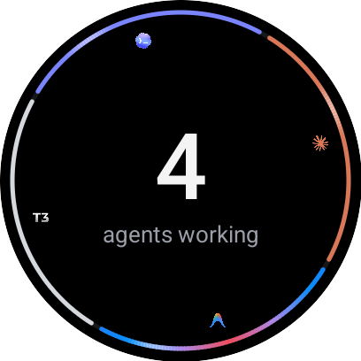
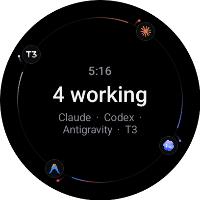
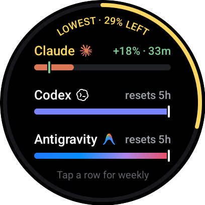
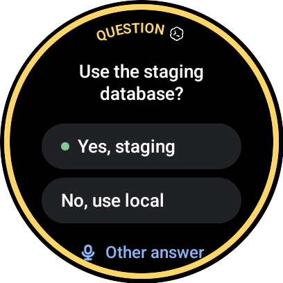
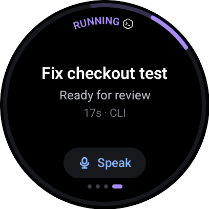
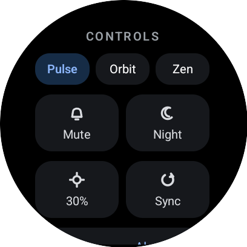
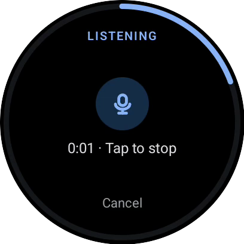
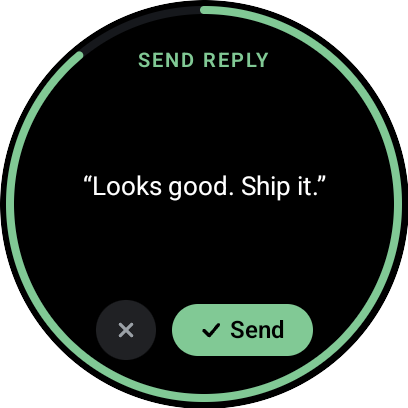
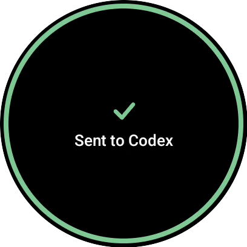

# Agent HUD



<sub>Concept render of the watch on a desk dock; the screen is a real capture from the app.</sub>

A Pixel Watch 3 that sits on your desk and shows what your AI coding agents are doing, so you can glance over instead of switching windows. It tracks **Claude** (Claude Code and Claude Desktop), **Codex**, **Antigravity** and **T3 Code**, plus your plan quotas from CodexBar, and lets you act from the watch: approve, deny, tap an answer to a question, or reply by voice.

Three pieces:

| Folder | What it is |
|---|---|
| `watch-hud/` | The Wear OS app (Kotlin, Jetpack Compose). Runs as the watch's home screen. |
| `mac-agent-bridge/` | A small Node service on your Mac. Watches each agent's local session files and databases and streams one live snapshot to the watch over Wi-Fi. |
| `watch-threads/` | **Agent Threads**, the on-the-wrist companion app (Wear OS, Compose): browse, read and reply to conversations. See below. |
| `relay/` | Cloudflare Worker that lets Agent Threads reach the Mac from any network. |
| `mac-app/` | **Agent HUD.app**, a menu bar app that runs and supervises the bridge, with a dashboard. |
| `firmware-mod/` | Experimental root/flash tooling and a no-root de-Google script. See the warning below. |

## Screenshots

Captured on the watch (408 × 408).

| Pulse | Orbit | Quotas |
|:---:|:---:|:---:|
|  |  |  |
| **Question** | **Agent** | **Controls** |
|  |  |  |
| **Listening** | **Review** | **Sent** |
|  |  |  |

## On the watch

- **Home layouts** (pick in Controls): **Pulse**, one segment per agent around the edge; **Orbit**, each agent's logo travels a hairline track; **Zen**, type only.
- **Provider identity:** each agent's real logo, with color only while it's working. Claude is clay, Codex periwinkle, Antigravity a slowly drifting Gemini gradient, T3 Code platinum. Working agents carry a fading trail (and a small satellite dot in Orbit).
- **Waiting on you:** when an agent needs an approval or an answer, its arc turns amber and an aurora of warm light rises from it toward the center. Idle agents go gray.
- **Agent screen:** the latest step, the question with tappable choices, Proceed / Deny, and voice replies (transcribed on the Mac), with clear Sent / Couldn't send feedback.
- **Quotas:** bars or rings in provider colors, with an even-pace marker (in reserve / in deficit) and reset times for the 5-hour and weekly windows.
- **Alerts & vibration:** strength, which events buzz (needs you, errors, an agent starting or finishing, and more), reminders, quiet hours, and an optional "done" card.
- **Screen:** always on, on while charging only, or auto-off after 2 or 5 minutes off the charger.
- **Crown:** scrolls lists and moves between pages. The HUD is the watch's home app, and Controls has buttons back to the stock watch face, apps and settings.

## Setup

### 1. Mac app and bridge

```bash
cd mac-agent-bridge && npm install && cd ..
./mac-app/scripts/make_signing_identity.sh   # once: local code-signing identity (keeps macOS permissions across rebuilds)
./mac-app/build.sh
cp -R "mac-app/build/Agent HUD.app" /Applications/
open "/Applications/Agent HUD.app"
```

Agent HUD starts the bridge, restarts it if it crashes or hangs, and can launch at login. It runs a copy of the bridge **bundled inside the app**, so after changing anything in `mac-agent-bridge/`, rebuild and reinstall the app.

To type watch replies into your agent apps, grant **Agent HUD** Accessibility access (System Settings > Privacy & Security > Accessibility), and allow it to control System Events when macOS asks. The dashboard shows the status of both.

Voice replies use `whisper-cli` (Homebrew `whisper-cpp`) with the `ggml-base.en` model in `~/Library/Application Support/AgentHUD/models/` (or `mac-agent-bridge/models/`). The model isn't in the repo.

Check the bridge: `curl http://127.0.0.1:8765/health`

### 2. Watch app

```bash
cd watch-hud
./gradlew assembleRelease
../scripts/wadb install -r app/build/outputs/apk/release/app-release.apk
```

Install the release build: it's optimized and runs noticeably smoother than the debug build (`assembleDebug`). Both are signed with the local debug key, so either installs over the other.

The Android build tools need JDK 17 or 21. If your default Java is newer, point Gradle at Android Studio's bundled JDK first: `export JAVA_HOME="/Applications/Android Studio.app/Contents/jbr/Contents/Home"`.

The build bakes in the bridge's auth token from `~/.agenthud-bridge-token` (created by the bridge on first run). The watch finds the Mac over Bonjour (`_agenthud._tcp`) on the same Wi-Fi network.

`scripts/wadb` is `adb` pointed at the watch only. It finds the Pixel Watch by model, preferring USB and falling back to paired Wi-Fi debugging, so it never touches a phone that's also connected. Set `WATCH_SERIAL` to pin a specific device.

### Try it without a live agent

```bash
curl -X POST http://127.0.0.1:8765/event -H 'Content-Type: application/json' \
  -d '{"id":"demo:1","provider":"codex","providerLabel":"Codex","title":"Deploy preview","status":"waiting_approval","prompt":"Run the deploy?","options":["Proceed","Deny"]}'
# clear it
curl -X POST http://127.0.0.1:8765/event -H 'Content-Type: application/json' -d '{"id":"demo:1","clear":true}'
```

Test threads never type into any app.

## How each agent is read

| Agent | Source |
|---|---|
| Claude Code / Desktop | Session transcripts in `~/.claude/projects` and Claude Desktop's session records. "Working" means a turn is in progress. |
| Codex | Codex's local SQLite databases in `~/.codex`. Replies are queued into Codex directly. |
| Antigravity | The live `steps` table in each conversation's database (`~/.gemini/antigravity/conversations`), plus its transcript for text and questions. |
| T3 Code | T3's local state database (`orchestration_v2_*` tables). |
| Quotas | The CodexBar CLI. |

## Agent Threads (on the wrist)

A spinoff for the watch you wear rather than the one on the desk. Where the HUD shows what's happening right now, Agent Threads is for keeping conversations going while you're away from the Mac:

- **Conversations:** every conversation from the last week across T3 Code, Claude Code, Codex and Antigravity, newest first, with anything waiting on you at the top. Tap the chip at the top to show one app at a time.
- **Reading:** messages appear as bubbles, with tool runs folded into a single gray line ("6 steps · Bash, Edit"). Long replies show a preview, and **Read all** opens the whole message. It opens at the newest message and follows new ones while the agent works.
- **Replying:** **Speak** (watch mic, transcribed on the Mac by whisper.cpp, then reviewed before sending), **Type** (the watch keyboard), or **Quick** replies ("Continue", "Yes, go ahead", ...). Open questions and approvals show their choices as buttons.
- It's an ordinary app, not a home screen, and it only uses the network while it's open.

Replies go to **that exact conversation**, not whatever chat is open on the Mac:

| App | How a reply is delivered |
|---|---|
| T3 Code | `t3 thread send <id>`. If the thread is busy, the reply becomes its next turn. |
| Codex | `codex queue --thread <id> --resume` |
| Claude Code | `claude -p --resume <id>`, run headless in the session's folder with the session's own permission mode. Refused while that session is mid-turn. |
| Antigravity | `agy acp --app-data-dir antigravity` resumes any desktop conversation by id headlessly (even when the Mac is locked), with approval prompts forwarded to the watch. Falls back to typing into the newest chat if `agy` isn't installed. |

Bridge endpoints (same token as the HUD): `GET /conversations`, `GET /conversation?id=&limit=`, `POST /conversation/reply {id, text}`. Answers to open questions use the HUD's `POST /action`.

```bash
cd watch-threads
./gradlew assembleRelease
adb -s <watch> install -r app/build/outputs/apk/release/app-release.apk
```

It finds the Mac over Bonjour, like the HUD. On Android 17 watches (Pixel Watch 5), allow **local network** access when the app asks.

### Away from home (relay)

At home the watch talks to the Mac directly. Anywhere else (another Wi-Fi, LTE, or the phone's Bluetooth link) it goes through a small Cloudflare relay in `relay/`:

```
Mac bridge ──outbound WebSocket──▶ Cloudflare Worker + Durable Object ◀──HTTPS── watch
```

- The Mac dials out, so nothing on the home network is opened to the internet.
- The relay forwards only the wrist app's endpoints (conversations, replies, answers, images, speech-to-text). The desk HUD's "type into the front app" features are never reachable from the internet, and the bridge enforces the same allowlist itself.
- Both sides must hold the bridge token. Cloudflare stores only its SHA-256, as the secret `TOKEN_SHA256`.
- The watch learns the relay address from the Mac while it's home (response header `X-Relay-Url`), switches to the relay only when it can't *connect* directly (so nothing is ever sent twice), and quietly checks for home again every minute.
- On the relay the watch releases its Wi-Fi hold, so Wear OS uses the cheapest link (usually the phone's Bluetooth).

No phone companion app is needed. The watch already reaches the internet through the phone over Bluetooth when it's nearby, and over LTE or Wi-Fi when it isn't.

Setup (already done for this Mac):

```bash
cd relay && wrangler deploy
printf %s "$(tr -d '\n' < ~/.agenthud-bridge-token)" | shasum -a 256 | cut -d' ' -f1 | tr -d '\n' | wrangler secret put TOKEN_SHA256
echo https://agent-threads-relay.<your-subdomain>.workers.dev > ~/.agenthud-relay-url   # then restart Agent HUD
```

The Agent HUD dashboard's `/health` shows the relay link (`relay.connected`). To test locally: put `TOKEN_SHA256=…` in `relay/.dev.vars` (git-ignored), run `wrangler dev`, and start a bridge with `AGENT_HUD_RELAY_URL=http://<mac-ip>:8787`.

## Firmware (experimental, not ready)

`firmware-mod/` holds an unfinished plan to unlock, root and flash the watch (Magisk module, charge cap, debloat). **Don't run the flash scripts as they are:** they patch `boot` rather than `init_boot`, the charge-cap paths don't exist on this watch, and recovery assumes a factory image that hasn't been confirmed. Unlocking wipes the watch, and you must never relock the bootloader while it's modified.

`firmware-mod/degoogle/` is separate and safe: a reversible, no-root pass that removes optional Google apps and turns off LTE and Bluetooth (`apply.sh`, undone by `restore.sh`).

See `HANDOFF.md` for the detailed engineering notes and history.
